# 中国铁路 12306 — 订票流程编排

[English](README.md) | [简体中文](README.zh-CN.md)

**可靠业务自动化 · Node.js CLI · 任务编排 · 故障恢复**

这是一个围绕中国铁路官方票务平台 12306 开发的个人工程项目。我定义产品流程，设计架构和恢复模型，指导实现，并负责验收。

**已完成限定场景的 Direct 与 HouBu 真实平台线上验证**，在各自记录的历史版本中取得以下结果：

| 业务路径 | 线上观察结果 | 证据 |
| --- | --- | --- |
| **Direct · 直接购票** | 创建订单 → **等待用户手动支付** | [2026-09-28 运行记录](assets/evidence/controlled-use.md#h-direct--awaiting-payment) |
| **HouBu · 官方候补** | 关联到原始执行尝试的候补请求 → **等待用户手动预付款** | [2026-09-27 运行记录](assets/evidence/controlled-use.md#h-houbu--awaiting-prepayment) |

这些结果来自真实平台运行。支付完成、最终出票及长期生产稳定性不在已证明范围内。本仓库公开精选架构、实现示例和脱敏证据；订票实现保留在私有项目中。

## 难点在哪里

**春节（春运）和国庆**期间，出行需求集中于特定日期和线路，热门车次供不应求，购票难度上升。[官方平台与节假日背景来源 →](docs/platform-context.md)

工程难点不止是发现一张余票：

- **时机与动态库存：**等待起售、观察余票，并在行动前重新核查。
- **共享账号与独立意图：**协调多个任务及会话健康，避免把余票当成提交许可。
- **不确定的副作用：**超时可能掩盖已存在的订单；重试必须保留原始身份并防止重复提交。

预约系统、订单处理和库存预留也面临这些问题。

## 我构建了什么

一套本地 CLI 系统：接收固定目标，协调长期任务，维护会话健康，对每个执行步骤进行准入检查，并提示下一步安全操作。**Direct 和 HouBu 由用户明确选择**，不会自动切换。支付始终由用户手动完成。

## 工作流程

任务被接收不代表订票成功。两条路径都必须通过当前资格检查、受控提交和官方结果归属核实。未解决的结果保留为 **UNKNOWN**，不能触发盲目重新提交。[控制与恢复语义 →](docs/architecture.md#control-and-uncertainty)

## 系统架构

**JavaScript ES Modules · Node.js · 本地持久化状态 · Node 内置测试运行器**

一个 Booking Core 调度多个 Campaign（订票任务）；独立 Renewer 维护会话健康。共享查询闸门协调余票请求，持久化事实则在中断后保留任务身份、提交额度和本地占用。[职责与实际代码映射 →](docs/architecture.md)

## 三个工程决策

| 挑战 | 设计选择与用户价值 | 详情 |
| --- | --- | --- |
| 响应丢失与重复操作 | 稳定请求身份与持久化 FINAL 屏障，恢复已有工作，避免盲目重复提交 | [故障场景与证据追溯](docs/engineering-decisions.md#reliability-walkthrough-unknown-does-not-mean-retry) |
| 多个任务重叠 | 共享安全的余票观察结果，隔离私有执行材料与授权 | [调度与准入](docs/engineering-decisions.md#2-share-inventory-facts-while-keeping-execution-private) |
| 截止时间与恢复控制 | 通过同一调度器响应临近截止时间；区分查看、停止、核实与继续 | [取舍与源码摘录](docs/engineering-decisions.md#3-schedule-around-deadlines-and-explain-control-precisely) |

## 验证与我的贡献

上面的线上交接结果是主要业务成果。更早的[离线验收](assets/evidence/historical-offline.md)记录了另一固定版本（2026-09-20）的 **21 项关卡和 1,494 项测试通过**。[本版公开检查](assets/evidence/local-checks.json)验证当前仓库及两个小型纯函数，不会重新运行私有集成测试。[版本、失败记录与未覆盖范围 →](docs/validation.md)

我负责需求、架构、故障场景与验收，并使用 AI 辅助实现和技术评审。[作者贡献与保留的私有范围 →](docs/authorship-and-scope.md)

**继续阅读：**[五张可编辑图](diagrams/README.md) · [工程决策](docs/engineering-decisions.md) · [真实视觉证据补充计划](docs/validation.md#visual-evidence-follow-up)

复现公开检查

使用 Node.js 运行 `node scripts/check.mjs`，无需凭据或访问私有项目。图表重新导出与检查记录维护见[验证说明](docs/validation.md#reproduce-the-public-checks)。

本页为中文译本，图表及详细材料保留英文。独立个人项目，与中国铁路无隶属或背书关系。版权所有 © 2026 Devon。保留所有权利。
