# Three engineering decisions

The useful question is not simply whether a booking script can succeed. It is whether a user can understand and control it when requests, local state and remote outcomes disagree. These cases describe the selected written contract and its implementation basis. Historical run evidence and this edition's checks are distinguished in [validation](validation.md).

## 1. Prevent duplicate submission without inventing certainty

### Problem

A client can lose the acceptance response after a task was committed. Later, a network timeout can occur after an external submission may already have taken effect. Treating both as “failed; try again” can create a second task or repeat a business operation.

### Alternatives

| Choice | Advantage | Cost or failure mode |
| --- | --- | --- |
| Retry every failed command with a new identity | Simple caller logic | Lost responses can duplicate accepted work |
| Deduplicate by target alone | Catches some accidental repeats | Two genuine requests can share a target; identity and intent are different |
| Stable request identity plus a per-Attempt FINAL barrier | Recovers local receipts and preserves external uncertainty | Requires durable commits, input binding and explicit reconciliation |

### Decision

The CLI preserves request identity before submission. The same identity and the same input retrieve the original receipt; the same identity with different input is rejected. Acceptance, bound authorization and ACK must agree durably. ACK is evidence of acceptance, not evidence of a ticket order.

An Attempt then freezes its input and records attributable Hold before possible business side effects. Each protocol step needs admission. FINAL additionally consumes a durable one-use barrier before dispatch. Losing a response, stopping a process or restarting Core does not restore that allowance.



### Reliability walkthrough: UNKNOWN does not mean retry

**An illustrative failure scenario, not a captured online run:** the final submission may have reached the platform, but its response is unavailable. The user then tries to continue. The table shows the intended evidence progression; the final row is conditional, not a result observed in the same experiment.

| Point | Durable facts / evidence | Allowed behavior | Trace |
| --- | --- | --- | --- |
| Before final dispatch | Original Attempt and fixed input; FINAL allowance consumed | Admit the selected submission once | S01 contract; S13 Attempt facts |
| Response unavailable | `SUBMIT_UNKNOWN`; FINAL remains taken | Preserve the Attempt; do not infer remote failure or refund FINAL | S01, S07 uncertainty rules |
| User asks to continue | Last Attempt has `PHASE_UNKNOWN`, or FINAL result is unresolved | Refuse with `CONTINUE_BLOCKED_UNKNOWN`; explain reconciliation | S15 `evaluateContinueEligibility` |
| Bounded read is empty or incomplete | No sufficient proof resolving the original operation | Remain unresolved; the cited FINAL-unknown fixture keeps Hold even with an exact-empty read | S19 `W4C-V4` assertions |
| Local Hold is absent | Durable Attempt still says `PHASE_UNKNOWN` | Continue remains blocked; missing occupancy cannot erase the Attempt | S19 `R3` assertions |
| If complete matching order evidence exists | Target, original-Attempt attribution and official lifecycle agree | Report the attributed result; awaiting payment retains Hold | S19 `W4C-V2` matching-order fixture; separate [Direct online record](../assets/evidence/controlled-use.md#h-direct--awaiting-payment) |

The key implementation rule can be expressed as **adapted pseudocode**, simplified from S15, with earlier validation and other refusal branches omitted:

```text
if lastAttempt.outcome == PHASE_UNKNOWN:
    refuse(CONTINUE_BLOCKED_UNKNOWN)
if result == SUBMIT_UNKNOWN or (FINAL.taken and FINAL.result != EXPLICIT_FAILURE):
    refuse(CONTINUE_BLOCKED_UNKNOWN)
```

The inspected implementation is `lib/core/resume-continue.mjs`; the named fixtures are in `tests/w4c-resume-continue.test.mjs`, under the private CLI package. S15 and S19 were read again on **2026-10-16** and their full-file hashes matched the [source catalogue](../assets/evidence/source-catalog.json). No private code was executed. The test assertions are implementation evidence, **not new passing results** or proof that the historical offline total covers them.

The [HouBu online record](../assets/evidence/controlled-use.md#h-houbu--awaiting-prepayment) is a different case: its displayed UNKNOWN came from a later summary-classification overwrite. It is not evidence that an original confirmation response was lost.

### Cost and boundary

This favors preserving evidence over automatic retry. A user may need reconciliation before continuing. Pre-final calls can also have side effects, so FINAL=0 alone is not a release proof. Versioned local-Hold release rules must be assessed separately: a permitted local release does not prove remote failure or turn UNKNOWN into a failed Attempt. A later serial Attempt needs independent normal-control eligibility; resume does not create it.

The claim is **duplicate-submission prevention and uncertainty-aware recovery within explicit boundaries**, not end-to-end exactly-once delivery across an external platform.

### Evidence and transferable value

S16 contains lost-ACK/EPIPE and committed-fact projection tests; S19 defines resume/continue refusal and reconciliation tests. Their presence is implementation evidence, not a claim that they were run for this edition. [H-A3](../assets/evidence/historical-offline.md) records a fixed-version historical offline acceptance. [H-HOUBU](../assets/evidence/controlled-use.md#h-houbu--awaiting-prepayment) shows why later authoritative lifecycle evidence must be separated from a misleading FINAL summary field.

The same problem appears in appointment booking, order creation and inventory reservation: recovering the user's existing intention is safer than manufacturing a new one after every timeout.

## 2. Share inventory facts while keeping execution private

### Problem

Several Campaigns can observe overlapping inventory. Independent polling workers duplicate work and can create inconsistent per-task limits. Sharing everything, however, would leak private Candidate or accidentally treat a query hit as permission to submit.

### Alternatives

| Choice | Advantage | Cost or failure mode |
| --- | --- | --- |
| One process and query loop per Campaign | Easy local ownership | Duplicate requests, competing limits and harder cross-task coordination |
| One shared result plus shared private context | Less repeated work | Confuses public observations with task-bound identity and execution authority |
| One Core scheduler, shared observations and private admission | Reuses inventory work while preserving boundaries | Needs fairness, lifetime checks and a common physical dispatch gate |

### Decision

Same-key subscriptions share pending/in-flight anonymous inventory work and safe Observation facts. The query key describes the response conditions, not the passenger. Different due keys receive fair scheduling. A query hit must still match the frozen target and selected Direct/HouBu path.

An eligible opportunity requests a bounded authenticated recheck through the same physical query gate. The resulting Candidate is private. Current authorization, owner, Session health/revision, stop, temporary account activity, target and conflicting Hold are checked before side effects. A gate-ready hint is not a reservation; if final dispatch cannot proceed, temporary activity is released rather than held during a wait.



### Cost and boundary

Shared coordination reduces duplicate work but creates a more demanding admission boundary. Existing Hold does not stop other eligible tasks from fair anonymous observation; it still constrains new business effects. The written contract normally spaces query starts by 3 seconds and defines one narrowly bound priority exception. This edition does not infer online performance or throughput from that design.

### Evidence and transferable value

S11 and S12 identify the scheduler and physical gate; S18 identifies scheduling test definitions. The [architecture ownership table](architecture.md#state-ownership-and-write-boundaries) explains writers and readers. [H-A3](../assets/evidence/historical-offline.md) provides historical integration/installation context, without assigning its entire test result to the later amended scheduler.

The transferable choice is to **share information that is safe to reuse while isolating identity, permission and side effects**. This is useful in monitoring, reservation and multi-workflow automation systems.

## 3. Schedule around deadlines and explain control precisely

### Problem

A fixed polling interval can delay a nearby sale deadline. Aggressive polling wastes work. Wall-clock changes can invalidate timing assumptions. Meanwhile, a user needs different actions for stopping future work, checking an existing result and continuing a task.

### Alternatives

| Choice | Advantage | Cost or failure mode |
| --- | --- | --- |
| Fixed loop only | Small implementation | Nearby deadlines wait for the next regular pass |
| Busy polling or one timer per side effect | Responsive in simple cases | Extra work or a second execution path that can bypass admission |
| Deadline-aware wake planning with one scheduler path | Reacts to nearby deadlines without a second dispatch engine | Requires plan invalidation, clock checks and honest timing measurements |

### Decision: a wake-up is not a network send

The control loop uses the nearest eligible deadline to shorten its ordinary poll delay. The callback returns to the existing scheduler; it does not send business requests directly. Current admission and the shared gate still decide whether a network call is allowed.

The following is a **verbatim function excerpt** from S10, with surrounding comments omitted. It computes a delay; it neither validates every domain input nor performs scheduling or I/O.

```js
export function computeNextWakeDelay({ nowMs, deadlines, maxPollMs = 100 }) {
  if (!Number.isFinite(nowMs) || !Number.isFinite(maxPollMs) || maxPollMs <= 0) {
    throw new TypeError("WAKE_PLAN_INVALID");
  }
  let delay = maxPollMs;
  for (const deadline of deadlines) {
    if (Number.isFinite(deadline)) delay = Math.min(delay, Math.max(0, deadline - nowMs));
  }
  return delay;
}
```

The second **verbatim function excerpt** compares wall-clock and monotonic samples from the same process. Monotonic values must not be compared across process lifetimes.

```js
export function classifyClockTransition(previous, current, { jumpMs = 1000, pauseMs = 5000 } = {}) {
  if (!previous) return { uncertain: false, resumed: false, errorMs: 0, reason: null };
  const wallDelta = current.wallMs - previous.wallMs;
  const monoDelta = current.monoMs - previous.monoMs;
  const errorMs = wallDelta - monoDelta;
  const reason = monoDelta < 0 ? "MONOTONIC_REGRESSION"
    : !Number.isFinite(errorMs) || Math.abs(errorMs) > jumpMs ? "WALL_CLOCK_JUMP" : null;
  return {
    uncertain: reason !== null,
    resumed: monoDelta > pauseMs,
    errorMs,
    reason,
  };
}
```

The caller owns the consequence of a clock anomaly. In the selected contract, uncertain timing is latched for relevant scheduled work until the permitted explicit recovery path. This helper by itself does not enforce that rule. It also separates a long pause from clock disagreement; it does not establish a trustworthy clock after every possible host event.

### Decision: expose different user intentions



| Intention | Interface | Promise and boundary |
| --- | --- | --- |
| Inspect | Plain `status` | Read local committed facts; no official requests or business writes |
| Stop future work | `stop` | Record stop intent; do not cancel orders or pretend an in-flight request was recalled |
| Check an existing result | `run --resume` | Reuse trusted historical evidence or reconcile the original identity; no FINAL replay or activation |
| Explicitly continue | `run --continue` | Revalidate the unfinished Campaign; do not clear UNKNOWN or restore consumed FINAL |

Explicit status refresh/login-verification branches have their own boundaries; they are not part of the plain read-only promise.

### Cost, evidence and transferable value

The system records wake time separately from first actual inventory dispatch. Cold initialization and gate waiting remain part of observed delay. Missing measurements stay unavailable rather than becoming zero. The 30-second project performance target is a target, not a measured SLA or permission to discard correctness checks.

S17 contains timing and clock test definitions. This edition runs only the two published pure functions with synthetic inputs; results and exact limits appear in [the local verification record](../assets/evidence/local-checks.json). [H-DIRECT](../assets/evidence/controlled-use.md#h-direct--awaiting-payment) records one historical successful handoff while retaining a temporary health-readiness anomaly.

These choices transfer to scheduled jobs and business automation: responsive scheduling must still preserve one execution boundary, and clear user controls are part of reliability.

## Architecture evolution

The selected case explains the HTTP/CLI behavior baseline and filesystem-based durable state. Moving durable business state toward SQLite is a separate architectural evolution. This edition makes no claim about its completion, migration status or production acceptance, and does not reuse old ChatGPT branch-status descriptions as current evidence.
